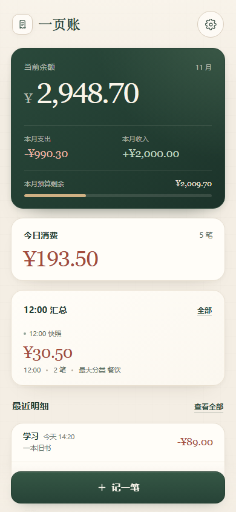
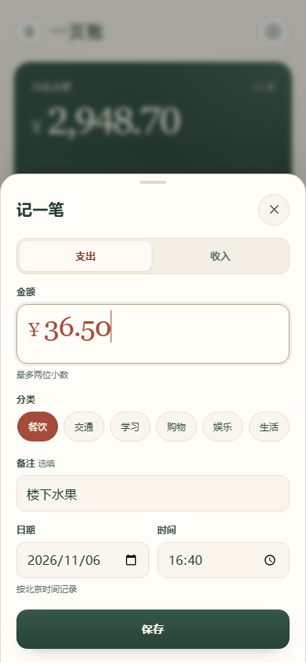
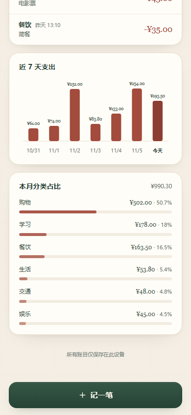
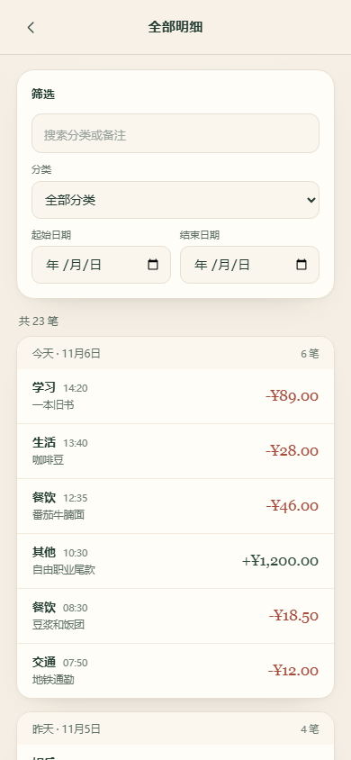
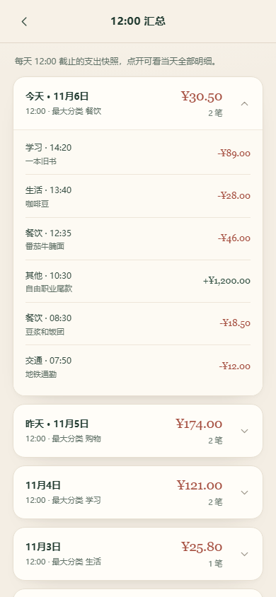
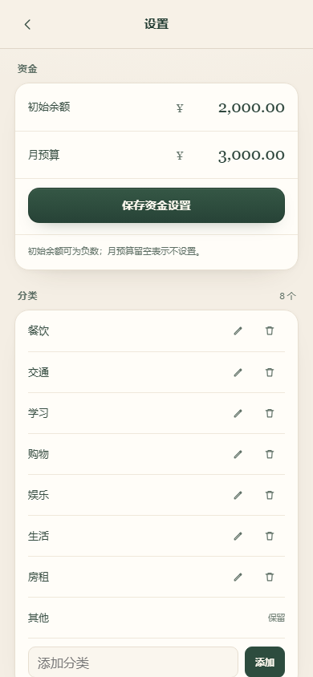
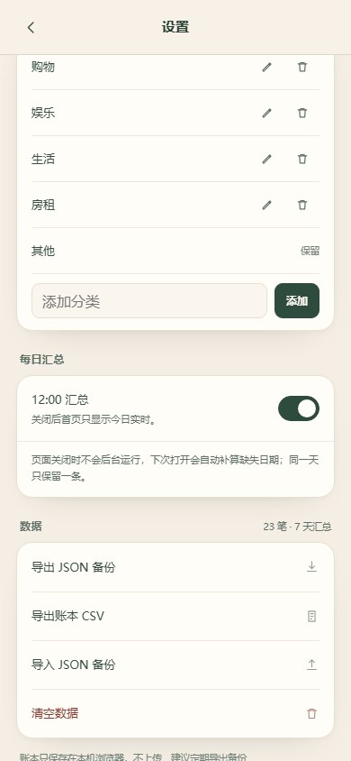
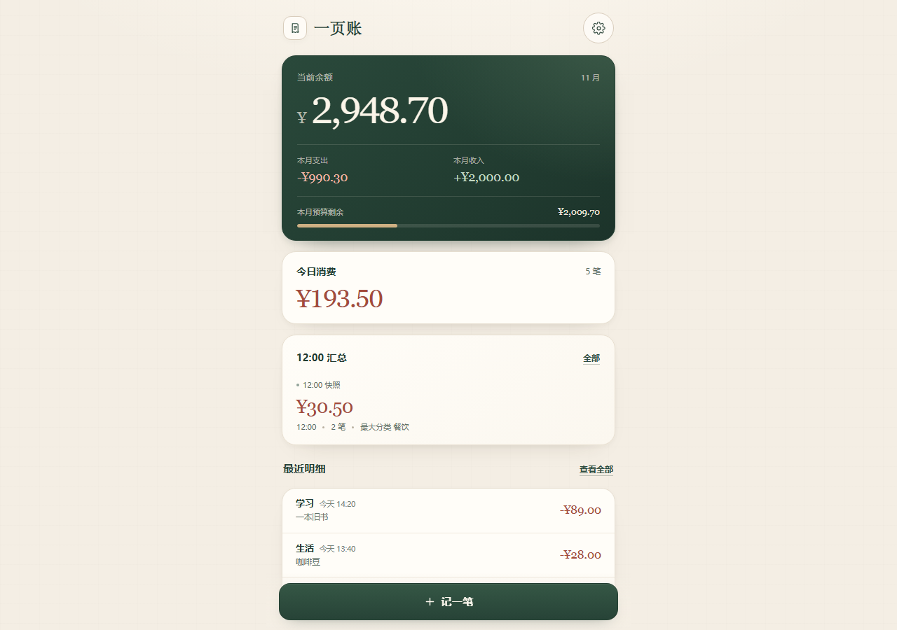

# 一页账 · 本地记账

一个移动端优先、打开就能用的本地记账 Web 应用。没有后端、没有登录、没有统计埋点，账目只保存在当前浏览器的本机 `localStorage`。

**在线使用：** <https://qing050306.github.io/one-page-ledger/>  
**源码仓库：** <https://github.com/qing050306/one-page-ledger>

在手机上打开在线地址后，可以通过浏览器菜单“添加到主屏幕”把它当作一个独立的小应用使用。首次打开是空白账本；下面的截图使用了演示数据。



## 目录

- [快速开始](#快速开始)
- [功能概览](#功能概览)
- [12:00 汇总的真实行为](#1200-汇总的真实行为)
- [资金与预算](#资金与预算)
- [记账、编辑与删除](#记账编辑与删除)
- [分类管理](#分类管理)
- [筛选与汇总明细](#筛选与汇总明细)
- [导入、导出与清空](#导入导出与清空)
- [数据、隐私与备份](#数据隐私与备份)
- [PWA 与离线](#pwa-与离线)
- [项目结构与技术](#项目结构与技术)
- [设计与兼容性](#设计与兼容性)
- [截图](#截图)

## 快速开始

### 直接打开

双击 `index.html` 即可使用，不需要安装 Node.js、数据库或服务器。账目会保存在这个文件所在的浏览器的本机存储里。

### 本地服务器方式

在项目目录执行：

```bash
python -m http.server 8080
```

然后访问 `http://localhost:8080/`。这种方式也能启用可选的 PWA 和离线缓存；直接双击 `index.html` 时，PWA 相关加载会自动跳过，应用本身仍然完整可用。

### 在线使用

打开 <https://qing050306.github.io/one-page-ledger/>。这是纯静态页面，不连接任何后端服务。

## 功能概览

- 首页固定顺序：余额卡、今日消费、12:00 汇总、最近明细、近 7 天柱状图、本月分类占比。
- 底部固定“记一笔”，右上角进入设置。
- 支出朱砂红，收入墨绿；金额以整数分保存，展示为 `¥xx.xx`。
- 记录可编辑日期和时间，可写备注；金额必须大于 0，最多两位小数。
- 所有日期、今天判断、月统计和 12:00 快照都按 `Asia/Shanghai`（北京时间）计算。
- 全部明细支持关键字、分类和日期范围筛选；编辑和删除都要二次确认。
- 12:00 汇总列表可以展开查看当天全部明细；汇总每日只有一条。
- 设置支持初始余额、月预算、分类增删改、汇总开关、JSON 备份、CSV 导出和清空数据。
- 可选的 PWA：安装到桌面、离线打开。

## 12:00 汇总的真实行为

12:00 汇总不是一张预置的静态卡片，而是按天写入本机数据的快照。

1. **统计范围**：只统计当天 `00:00:00` 到 `12:00:00`（含 12:00:00）的**支出**。收入不进入 12:00 汇总；当天 12:00 之后的支出也不进入。
2. **中午前**：首页显示“今日实时”，金额是今天到目前为止的全部消费。
3. **中午后**：首页读取当天已保存的 12:00 快照，显示金额、笔数、最大分类和“12:00 快照”标识。
4. **页面开着时**：页面会在北京时间 12:00 设置一个定时检查；到点后生成本日快照并刷新首页，不需要手动刷新。
5. **页面关着时**：关闭页面不会有后台任务，但下次打开会立即补生成缺失日期的汇总。页面从后台回到前台、重新获得可见性时也会再检查一次。
6. **唯一性**：快照以日期为键，同一天永远只有一条；生成时会覆盖同日的旧值，不会追加重复记录。
7. **修改和删除**：12:00 后若修改或删除当天 12:00 之前的账目，当天快照会按最新数据重算；修改 12:00 之后的账目只影响今日实时和余额，不影响 12:00 快照。
8. **开关关闭**：设置中关闭“12:00 汇总”后，首页隐藏汇总卡，只保留今日实时；历史快照数据仍保留，只是不再展示。再次开启时会重算快照并补齐缺失日期。
9. **空账本**：没有任何账目时不会创建空的日汇总；一旦有账目，从最早账目所在日期到今天，中间缺失的日期会按规则补齐（没有 12:00 前支出的日期会是一条金额为 0 的快照）。
10. **不伪造后台能力**：页面关闭期间不会运行任何定时器。所谓“补生成”发生在下次打开应用时，依据本机记录重新计算。

### 为什么首页有时显示“今日实时”

- 北京时间 12:00 前：显示实时金额。
- 12:00 后：如果当天已有快照，显示快照。
- 12:00 后但账本完全没有数据：没有快照可显示，会回落为“今日实时”的 0 元状态。记下第一笔账后，日汇总会按上面的规则开始生成。

## 资金与预算

- **当前余额** = 初始余额 + 所有收入 − 所有支出。初始余额可以为负数。
- 本月支出、本月收入只统计当前北京时间月份。
- 月预算可选：留空表示不设置预算；填写时必须大于 0。设置后余额卡显示预算进度和“本月预算剩余”。
- 本月支出超过预算时显示“已超预算”，用红色提示超出的金额。
- 更改初始余额或预算不会改动已有账目；它们只影响余额、进度和展示。
- 资金输入支持最多两位小数，负数初始余额可以写成 `-100.50`。

## 记账、编辑与删除

- 点击底部“记一笔”打开底部弹层。
- 可以选择支出/收入、填写金额、选择分类、填写备注，并修改日期和时间；日期时间默认是当前北京时间。
- 不能保存晚于当前时刻的记录。
- 金额输入使用整数分转换，拒绝空值、0、负数和超过两位小数的输入。
- 新记账保存时会禁用重复提交；保存失败会保留弹层和输入。
- 点击一笔账目进入编辑。修改保存前会再弹一次确认，确认后才写入。
- 编辑弹层里的删除按钮需要再次确认；删除后余额、图表和受影响的 12:00 汇总都会重算。
- 所有反馈使用页面内 toast、错误文字或确认弹层，不使用 `alert`。
- 备注通过 `textContent` 渲染，分类名也作为文本处理，避免把用户输入当成 HTML。

### 记录弹层



## 分类管理

默认分类：**餐饮、交通、学习、购物、娱乐、生活、房租、其他**。

- 可以新增、改名、删除分类；分类名最多 12 个字，空名称和同名分类会被拒绝（忽略大小写比较）。
- **其他**是固定保留分类：不能改名、不能删除。
- 删除自定义分类时：
  - 如果该分类没有被账目使用，直接删除。
  - 如果被使用，会先显示使用笔数；确认后，这些账目自动归入“其他”，余额不变，相关统计和 12:00 汇总重算。
- 分类改名后，历史账目会立即显示新名称。
- 新增分类会插入“其他”之前。

## 筛选与汇总明细

进入“全部明细”后：

- 明细按日期分组，同一天按时间从新到旧排列；日期组也按新到旧排列。
- 关键字同时匹配分类名和备注。
- 分类筛选、起始日期、结束日期可以组合使用；日期范围包含首尾两天。
- 起始日期晚于结束日期时会显示错误提示，不会产生错误结果。
- 筛选条件生效时出现“重置”入口。
- 修改或删除账目后，在当前筛选条件下会立即刷新结果和总计。

12:00 汇总列表按日期倒序排列，点击一条日期卡可以展开当天全部明细；再次点击收起。主页的“全部”入口只在已有汇总时出现。

## 导入、导出与清空

### JSON 备份

设置 → 数据 → “导出 JSON 备份”会下载一个带时间戳的 JSON 文件。它包含：

- 全部账目、全部 12:00 汇总；
- 初始余额、月预算、分类列表和汇总开关；
- 格式标记和版本号。

导入时会先做结构、版本、分类引用、金额和日期校验，再弹出“导入并覆盖当前数据？”的确认。导入是**整体覆盖**，不会合并。导出的数据再导入后，账目、汇总和设置会保持一致；需要换设备时可以用它迁移。

### CSV 导出

“导出账本 CSV”生成 UTF-8 with BOM 的表格文件，列为：

| 日期 | 类型 | 分类 | 金额 | 备注 |
| --- | --- | --- | --- | --- |
| 2026-11-06 08:30 | 支出 | 餐饮 | -18.50 | 豆浆和饭团 |

- 日期列带北京时间时分，便于表格排序。
- 支出金额为负数，收入为正数；金额不放在公式里，避免被表格软件当成公式。
- 文本字段会处理引号、逗号、换行和公式注入前缀。
- CSV 用于查阅和表格处理，不支持再导回本应用；需要完整迁移请用 JSON。

### 清空数据

“清空数据”需要手动输入“清空”后才解锁确认按钮。确认后会删除全部账目和 12:00 汇总；**初始余额、月预算、分类和汇总开关会保留**，且操作不可撤销。清空后按钮会变为不可用，直到再次记账。

## 数据、隐私与备份

- 存储键：`localStorage["ledger-v1"]`。
- 金额内部全部是整数分。
- 账目时间保存为带 `+08:00` 的 ISO 时间字符串。
- 每条账目包含：`id`、`type`、`amountCents`、`categoryId`、`note`、`at`、`createdAt`。
- 状态包含版本号、账目、汇总和设置；代码中留有按版本迁移的入口。
- 应用不发送账目数据，不连接第三方服务，没有统计埋点。PWA 的 manifest、图标和 service worker 也都来自本页面所在的站点。
- 数据只在当前浏览器/当前站点来源的本机存储中。清理浏览器站点数据、使用隐私模式或换浏览器后，账目不会自动出现；请定期导出 JSON 备份。
- 页面关闭后没有后台定时任务；再次打开会补算 12:00 汇总。

## PWA 与离线

PWA 是可选项：

- 通过 `http://localhost` 或 HTTPS 打开时，会自动加载同目录的 `manifest.webmanifest`、注册 `sw.js`，并提供 192/512/maskable 图标。
- 在支持的浏览器中可“安装”或“添加到主屏幕”，启动后是独立窗口。
- 首次在线打开后，应用外壳会被缓存；断网时再次打开仍可记账。账目仍存在本机 `localStorage`。
- 直接双击 `index.html`（`file://`）时不会注册 service worker、也不会插入 manifest，避免协议限制导致报错；核心功能不受影响。
- 如果更新了页面但浏览器仍显示旧缓存，可强制刷新一次或稍后重新打开；`sw.js` 使用网络优先的导航请求并在成功后更新本机缓存。

## 项目结构与技术

```text
ledger-app/
├── index.html                 # 完整应用：HTML + 内联 CSS + 内联 JS
├── manifest.webmanifest       # PWA 清单
├── sw.js                      # 可选的离线缓存 service worker
├── icon-192.png
├── icon-512.png
├── icon-maskable-512.png
├── apple-touch-icon.png
├── README.md
└── screenshots/
    ├── 01-home.png
    ├── 01b-home-lower.png
    ├── 02-entry-sheet.png
    ├── 03-all-records.png
    ├── 04-noon-summaries.png
    ├── 05-settings.png
    ├── 05b-settings-data.png
    └── 06-desktop.png
```

应用本身没有框架、构建步骤、CDN、图表库或外部字体：

- 原生 HTML/CSS/JavaScript；
- 原生 SVG 手写柱状图和分类比例条；
- `Intl.DateTimeFormat` 固定 `Asia/Shanghai`；
- 金额计算全部走整数分；
- 单文件主体方便直接打开，也方便放进任意静态托管。

## 设计与兼容性

- 以 390 × 844 的移动端视口设计；桌面端内容居中，最大宽度 520px。
- 暖米白纸张感背景、深墨绿余额卡、朱砂红支出、墨绿收入。
- 卡片约 20px 圆角、细边框、轻阴影；正文 13–14px；金额与余额使用衬线字体，标签和按钮使用无衬线字体。
- 390px 宽度下无横向滚动；长分类、长备注会截断/换行而不是撑破布局。
- 键盘可操作：弹层有焦点陷阱，Esc 可关闭最上层，焦点会恢复到触发按钮。
- 已在现代 Chromium 浏览器中检查移动端、桌面端、文件模式、PWA 清单/离线缓存、刷新持久化、导入导出和 12:00 定时补算流程。
- 不支持 JavaScript 时会显示提示；请启用 JavaScript 后使用。

## 截图

以下截图均为 390 × 844（最后一张为桌面端检查图），演示数据不随应用发布。

### 首页


### 首页下半部分：7 天柱状图与本月分类占比



### 全部明细



### 12:00 汇总列表（展开当天明细）



### 设置页





### 桌面端居中布局



---

如果只想记住一个地址：**<https://qing050306.github.io/one-page-ledger/>**。

